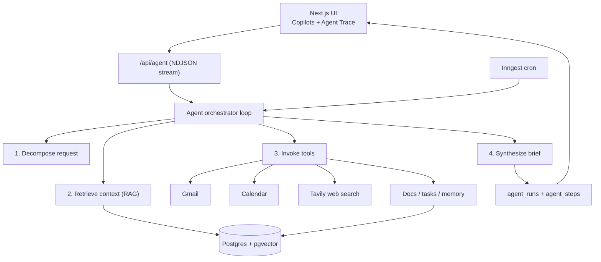

# VentureOS — Agentic Startup Operating System

VentureOS is an agentic operating platform that centralizes market research,
company knowledge, priorities, meetings, and execution context into a persistent
single source of truth for early-stage teams — and runs **transparent,
multi-step agents** on top of it through four role-specific copilots.

A founder types an ambiguous request ("prep me for the Sequoia call Thursday").
An agent loop decomposes it, retrieves relevant company context, invokes
specialized tools, and synthesizes an actionable brief — showing every
intermediate step in a live **Agent Trace** panel.

---

## Architecture



## Tech stack

- **Next.js 14** (App Router) + **TypeScript**, Tailwind + shadcn-style UI
- **Postgres** (Neon) with **pgvector**, via **Drizzle ORM**
- **Vercel AI SDK v6** + **OpenAI** for tool-calling agents & embeddings
- **Auth.js (NextAuth v5)** — Google login (+ Gmail/Calendar scopes) and a demo login
- **Inngest** for durable background runs & recurring workflows
- **Tavily** for external web research

## Runs fully offline

With **no API keys**, the app is still completely demoable:

- No `OPENAI_API_KEY` → the orchestrator uses a deterministic **mock agent** that
  still plans, retrieves real context, calls a tool, and streams a synthesized
  brief (embeddings fall back to a local hashing embedder, so RAG works).
- No Google/Tavily → tools degrade gracefully with clear labels.
- Log in with **"Continue in demo mode"** — no OAuth setup needed.

---

## Getting started

```bash
# 1. Install (Node 18.17+; Node 20 recommended)
npm install

# 2. Configure
cp .env.example .env.local
#   - Set DATABASE_URL to a Neon Postgres URL (pgvector supported)
#   - Optionally set AUTH_SECRET, OPENAI_API_KEY, GOOGLE_*, TAVILY_API_KEY

# 3. Create the schema (includes the pgvector extension)
npm run db:migrate      # applies drizzle/*.sql  (recommended)
#   — or, for rapid iteration, enable pgvector then: npm run db:push

# 4. Seed the demo startup (Ridgeline)
npm run db:seed

# 5. Run
npm run dev             # http://localhost:3000
```

### Background workflows (optional)

```bash
npx inngest-cli@latest dev   # runs the Inngest dev server + registers functions
```

## Project layout

```
src/
  app/
    (app)/            # authenticated shell: dashboard, copilots, knowledge, meetings, tasks, integrations, settings
    api/agent         # streaming agent runs (NDJSON)
    api/ingest        # document ingestion (PDF/TXT/MD → chunk → embed)
    api/tasks         # task CRUD
    api/inngest       # durable functions endpoint
    login/            # Google + demo login
  components/         # UI + AgentTrace, CopilotWorkspace, TaskBoard, ...
  lib/
    ai/               # orchestrator, tools, prompts, retrieval, embeddings, ingest
    db/               # drizzle schema, client, queries
    integrations/     # google (gmail/calendar), tavily
    inngest/          # client + functions
scripts/seed.ts       # demo data
drizzle/              # generated SQL migrations
```

## Deploy

Deploy to **Vercel** and point `DATABASE_URL` at Neon. Set the same env vars in
the Vercel project. Register the Inngest app for production cron.
